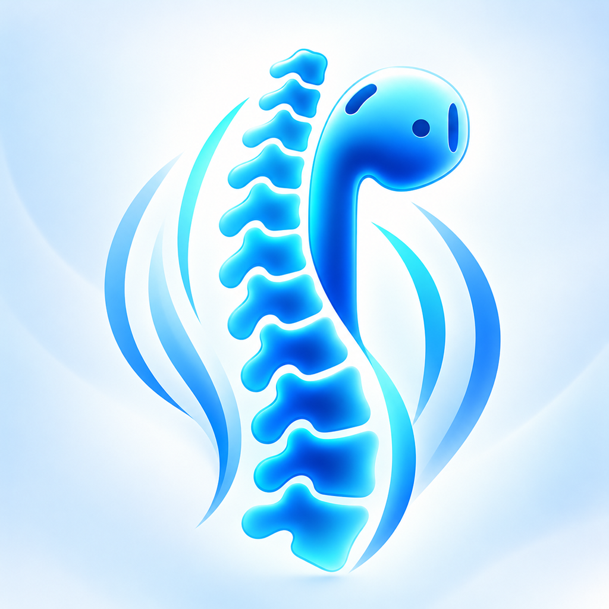
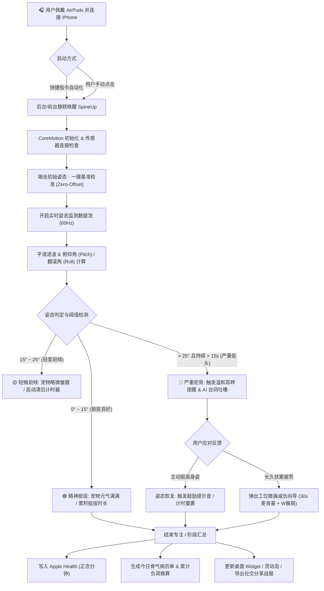
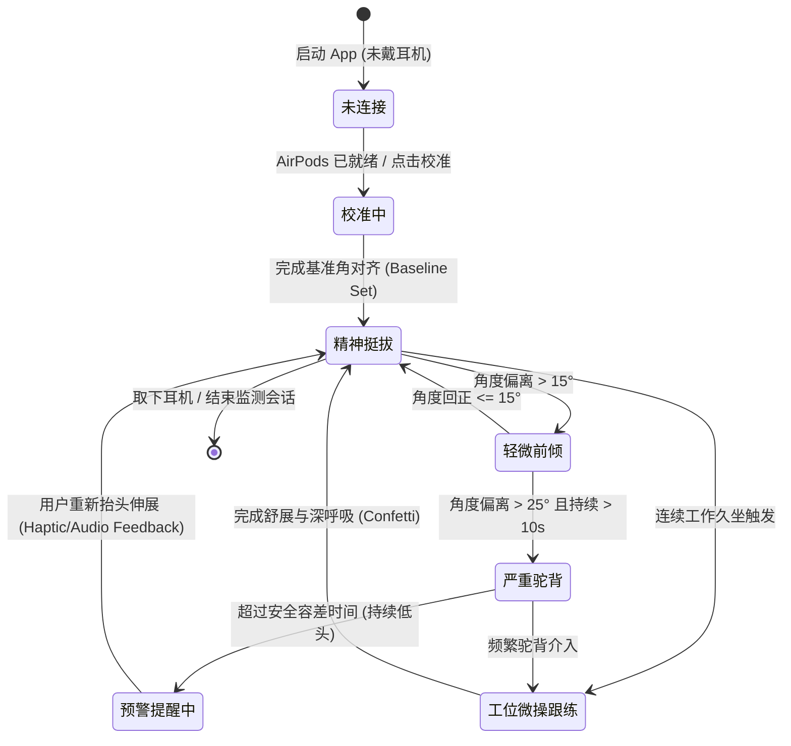

# 🧘‍♂️ SpineUp: AI Posture Pet (骨气)

<p align="center">
  
</p>

<p align="center">
  <strong>基于 AirPods 空间姿态感知 + AI 拟人情绪桌宠 + 生物力学模型的全生态无感体态守护应用</strong><br>
  <em>Smart Posture Tracking, Powered by Your AirPods. Better Spine, Effortless Posture.</em>
</p>

<p align="center">
  <a href="https://skyzizhu.github.io/SpineUp/"></a>
  
  
  
  
  
  
</p>

---

## 📑 目录

1. [项目概览与产品愿景](#1-项目概览与产品愿景)
2. [传统体态矫正痛点 vs SpineUp 破局方案](#2-传统体态矫正痛点-vs-spineup-破局方案)
3. [核心功能矩阵详述](#3-核心功能矩阵详述)
   - [3.1 AirPods 空间运动传感器姿态引擎](#31-airpods-空间运动传感器姿态引擎)
   - [3.2 AI 拟人情绪桌宠与语音陪伴](#32-ai-拟人情绪桌宠与语音陪伴)
   - [3.3 科学战报与骨气病历单](#33-科学战报与骨气病历单)
   - [3.4 工位减负微操跟练（视觉 AI 纠偏）](#34-工位减负微操跟练视觉-ai-纠偏)
   - [3.5 苹果全生态深度整合（HealthKit / 灵动岛 / 小组件 / 自动化）](#35-苹果全生态深度整合)
   - [3.6 100% 极致端侧隐私与无感安全](#36-100-极致端侧隐私与无感安全)
4. [端到端业务流程与状态机](#4-端到端业务流程与状态机)
   - [4.1 用户使用全链路闭环流程图](#41-用户使用全链路闭环流程图)
   - [4.2 姿态判定核心状态机](#42-姿态判定核心状态机)
5. [系统技术架构与分层设计](#5-系统技术架构与分层设计)
   - [5.1 整体分层架构 (MVVM + 协议驱动)](#51-整体分层架构-mvvm--协议驱动)
   - [5.2 核心模块目录拓扑结构](#52-核心模块目录拓扑结构)
   - [5.3 关键技术与开发规范](#53-关键技术与开发规范)
6. [支持硬件与兼容设备清单](#6-支持硬件与兼容设备清单)
7. [App Store 审核与合规设计](#7-app-store-审核与合规设计)
8. [多语言与国际化支持](#8-多语言与国际化支持)
9. [本地开发与编译构建指南](#9-本地开发与编译构建指南)
10. [相关链接与支持](#10-相关链接与支持)

---

## 1. 项目概览与产品愿景

**SpineUp (骨气)** 是一款专为办公室白领、程序员、学生及长时间低头伏案人群打造的**智能坐姿体态管理应用**。

在现代工作流中，“屏幕颈（Text Neck）”已成为全球性的职业亚健康问题。当头部前倾 15° 到 60° 时，颈椎所承受的等效重力会从正常的 5kg 骤增至 12kg~27kg。传统体态纠正方案往往依赖笨重外接穿戴硬件、常驻前置摄像头或死板生硬的机械警报，用户难以长期坚持。

**SpineUp 重新构想了体态守护的交互范式**：
* **零外接设备**：巧妙利用用户日常佩戴的 AirPods 内置六轴运动传感器，实现高精度、极低功耗的头部仰俯监测。
* **情绪价值驱动**：将枯燥的姿态角度转换为有温度、有喜怒哀乐的“AI 桌宠元气状态”，好姿态让宠物升级活力满满，坏姿态让宠物被巨石压扁呼救。
* **耳畔温和无感**：绝不打断深度专注与工作流，通过轻柔呼吸音、自然白噪音与空间音频柔和混音进行微提示。
* **融入苹果生态**：无缝打通 Apple Health 正念分钟、灵动岛 Live Activity、桌面交互式组件与 Siri 快捷指令戴耳机自动启。

---

## 2. 传统体态矫正痛点 vs SpineUp 破局方案

| 维度 | 传统硬件 / 传统 App 痛点 | SpineUp (骨气) 破局方案 |
| :--- | :--- | :--- |
| **硬件侵入性** | 需额外购买并佩戴物理背背佳、项圈或粘贴传感器；容易遗忘佩戴且充满社交尴尬感。 | **100% 依托现有 AirPods**：利用已有耳机内置运动传感器（`CMHeadphoneMotionManager`），办公听歌时自然开启，无额外穿戴负担。 |
| **隐私与耗电** | 许多软件依靠手机/电脑摄像头全天候开启扫描，发热严重、耗电极高，且在工位或私密空间引发强烈隐私焦虑。 | **零摄像头常驻**：日常监测纯走低功耗传感器芯片。**100% 本地运算**，零视频录制，零云端上传，无任何隐私外泄风险。 |
| **提醒体验** | 机械式“哔哔”蜂鸣声或刺耳弹窗，打断编码、会议与写作的心流体验，让人产生抵触心理。 | **耳畔温和混音（Audio Ducking）**：支持轻柔呼吸声、水滴声与空间声场微提示，混音叠加在正在播放的音乐/播客上，润物无声。 |
| **长期坚持动力** | 只有冰冷枯燥的角度数字与折线图，缺乏长期黏性，通常下载 3 天后被弃用。 | **AI 桌宠生命力机制**：将姿态与宠物形态深度绑定；内置毒舌、傲娇、治愈多重 AI 人设语音互动，将自律转化为游戏乐趣。 |
| **健康与力学依据** | 仅提示“不要驼背”，缺乏直观医学与生物力学解释。 | **Hansraj 颈椎生物力学负荷模型**：实时折算颈椎实际负重（如：当前前倾 30° 相当于脖子挂着 18kg 保龄球），科学感知健康损耗。 |
| **启动摩擦成本** | 每次开始工作都需要手动掏出手机解锁打开 App。 | **Siri 快捷指令自动化**：支持戴上 AirPods 蓝牙连接时自动静默唤醒 App 启动监测，实现“戴上即守护”。 |

---

## 3. 核心功能矩阵详述

### 3.1 AirPods 空间运动传感器姿态引擎
* **CoreMotion 6 轴数据融合**：
  基于 `CMHeadphoneMotionManager`，实时捕获 AirPods 的四元数（Quaternion）、旋转矩阵（Rotation Matrix）以及俯仰角（Pitch）、翻滚角（Roll）和偏航角（Yaw）。
* **自适应初始基准校准（Adaptive Calibration）**：
  解决不同用户工作环境差异（工位桌椅高度、屏幕视角、座椅靠背倾斜度）。支持在端坐初始状态下一键校准（Zero-offset Baseline），以用户的舒适自然坐姿作为基准零位。
* **三态姿态分级模型（Three-State Model）**：
  * 🟢 **精神挺拔 (Upright / Optimal)**：`0° ~ 15°`，颈椎生理曲度正常，承受基准中立负荷（约 5kg）。
  * 🟡 **轻微前倾 (Slight Slump / Warning)**：`15° ~ 25°`，中度预警，颈椎额外承重 7~13kg。
  * 🔴 **严重驼背 (Severe Slump / Critical)**：`> 25°`，高危负荷，颈椎额外承重 13~22kg+。
* **滞后容差与时间窗口滤波（Anti-Jitter Filtering）**：
  内置平滑低通滤波与时间迟滞保护（Hysteresis），自动过滤转头、喝水、点头等瞬时自然生理动作，仅在不良姿态持续超过设定窗口（默认 10~15 秒）后才触发预警，消除误报扰民。

---

### 3.2 AI 拟人情绪桌宠与语音陪伴
* **三重性格人格体系（SUPetPersona）**：
  1. **💼 毒舌打工人 (The Burned-Out Worker)**：*“反内卷 · 人间清醒”*。犀利自嘲，针针见血，用幽默诙谐的“互联网嘴替”催你挺起脊椎继续搬砖。
  2. **🐱 傲娇猫猫 (The Tsundere Cat)**：*“傲娇 · 猫咪视角”*。“不要趴着压扁本喵！你再驼背我就从你脖子上滑下去了喵！”
  3. **🧘 温柔私教 (The Gentle Coach)**：*“鼓励 · 正向引导”*。耐心指引深呼吸、微调整与体态复原，给予正向情绪价值与心理支撑。
* **动态情境台词构建引擎（SUPromptBuilder & SUPostureContext）**：
  根据用户的低头角度、持续时长、当前一天中的时刻（清晨、午后疲劳期、深夜加班）智能组装情境上下文，生成高度贴合场景的互动台词。
* **云端 + 离线双模 AI 架构**：
  * 离线状态下无缝回退至本地高质量离线语料库（`SUOfflineCorpus`），即便在飞行模式或弱网环境下依然能妙语连珠。
  * 结合系统 TTS（`SUSpeechManager`）与轻量音效系统，提供拟人化语音播报。

---

### 3.3 科学战报与骨气病历单
* **Hansraj 颈椎生物力学负荷折算**：
  根据国际脊柱外科权威 Kenneth K. Hansraj 教授经典临床模型，将低头俯仰角度动态折算为颈椎瞬时压力（kg）与全天累计额外承重量（Accumulated Extra Load）。
* **生活化趣味负重比喻（SUEquivalentItem）**：
  将抽象的公斤数自动转换为生活中的直观物品：
  * *“今日低头累计多承受了 12.6 kg，相当于脖子上挂了 2 个大西瓜 🍉 / 3 箱可乐 🥤 / 1 只沉睡的柯基 🐶”*。
* **多维综合健康评级体系**：
  通过综合姿态达标率（Upright Ratio）、不良姿态持续频次与正念时长，生成 **S / A / B / C / D** 五级骨气评级，并附带针对性的专业体态康复建议。
* **高颜值社交分享战报（SUShareCardView）**：
  支持一键生成带有玻璃拟态设计、宠物微表情、力学评分与今日金句的高清分享图，支持保存至相册或直接发送到微信、小红书与 Instagram。

---

### 3.4 工位减负微操跟练（视觉 AI 纠偏）
当用户长时间连续伏案或出现严重体态超标时，App 会温和建议开启 **2 分钟工位微操**：
* **科学设计的办公椅减负动作（SUPracticeActionType）**：
  * **动作 1：麦肯基收下巴 (McKenzie Chin Tuck)**（15s）：对抗头前引与乌龟颈，深层激活颈部深屈肌（Longus Colli）。
  * **动作 2：W 展肩夹背 (W-Stretch Scapular Retraction)**（15s）：沉肩坠肘并夹紧肩胛骨，有效打开胸椎前侧肌群，预防富贵包与圆肩。
* **前置摄像头视觉 AI 识别（SUPracticeVisionManager）**：
  * 采用 iOS 原生 Apple Vision 框架实现实时的面部与上身姿态关键点追踪（Vision Pose Detection）。
  * 实时判定动作是否做到位、并进行计数与倒计时。
  * 声明：摄像头数据仅在本地瞬时内存做骨骼特征提取，绝不录制、不保存、不上云。
* **正念呼吸律动引导与彩带正反馈**：
  * 配备物理弹性呼吸节律圈（`SUBreathingPacerView`），引导呼气吸气节奏。
  * 跟练完成后触发粒子礼花（`SUConfettiEmitterView`）与正念时长累加，提供即时多巴胺正反馈。

---

### 3.5 苹果全生态深度整合
* **Apple Health (健康) 原生联动**：
  经用户授权后，SpineUp 将每一次连续保持良好挺拔体态的专注时长，自动同步写入 Apple Health 的**「正念分钟 (Mindful Sessions)」**。体态好即等于身心专注，实现健康闭环。
* **灵动岛 (Dynamic Island) & 实时活动 (Live Activities)**：
  通过 ActivityKit 在灵动岛常驻显示当前实时姿态徽标、挺拔达标环与动态微表情；锁屏界面即刻查看今日挺拔时长，无需频繁解锁手机。
* **WidgetKit 桌面交互式小组件**：
  * 支持小号、中号、大号桌面组件与锁屏组件。
  * 基于 App Intents（`SUCalibrationIntent`）支持直接在桌面点击一键校准基准面，无需跳转应用内。
  * 通过 App Group（`group.com.iashes.anyway`）实现主 App 与 Widget 间毫秒级数据同步。
* **Siri 快捷指令与耳机自动化（Shortcuts Auto-Launch）**：
  利用 iOS 系统的快捷指令自动化功能，配置触发器为“当蓝牙连接至 AirPods 时”，系统可在耳机入耳戴上的瞬间在后台唤醒 SpineUp，实现“零点击自动化监测”。
* **iPhone Duo / 双屏与折叠屏自适应**：
  * **外屏紧凑态 (Compact)**：聚焦核心仪表盘与快速校准。
  * **内屏平展态 (Regular Split)**：自动升维为主次双栏分屏布局（左侧宠物实时动态，右侧骨气病历单与历史趋势）。
  * **桌面悬停态 (Tabletop Pose)**：上半部面向视线展示立宠与仪表，下半部平放展示控制面板与灵敏度滑块。

---

### 3.6 100% 极致端侧隐私与无感安全
* **完全免登录**：无需手机号、邮箱、微信登录，打开即用。
* **100% 端侧计算 (On-Device Processing)**：所有运动传感器数据、生物力学模型、姿态算法均在手机本地 SoC 芯片（A系列/M系列）计算完成。
* **零追踪与零广告**：不集成任何第三方商业追踪、打点或广告 SDK。
* **App Store 隐私标签认证**：在 App Store Connect 官方隐私问卷中被评定为最受信任的：**“开发者不会从此 App 中收集任何数据”**。

---

## 4. 端到端业务流程与状态机

### 4.1 用户使用全链路闭环流程图



---

### 4.2 姿态判定核心状态机



---

## 5. 系统技术架构与分层设计

### 5.1 整体分层架构 (MVVM + 协议驱动)

整个项目遵循严格的关注点分离（Separation of Concerns）与协议驱动开发（POP）：

```
┌────────────────────────────────────────────────────────────────────────┐
│                        Presentation Layer (UI)                         │
│  UIKit (VCs, Nav, Tab) + SnapKit 约束 + SwiftUI (仪表盘/动效/微操跟练)    │
└───────────────────────────────────┬────────────────────────────────────┘
                                    │ 绑定与驱动 (Combine / State / Delegates)
┌───────────────────────────────────▼────────────────────────────────────┐
│                        ViewModel / Feature Layer                       │
│  SUPostureMonitorViewModel · SUDailyReportViewModel · SettingsViewModel │
└───────────────────────────────────┬────────────────────────────────────┘
                                    │ 协议调用 (Protocols)
┌───────────────────────────────────▼────────────────────────────────────┐
│                         Core Services & Engines                        │
│  ├─ Motion: SUMotionServiceProtocol (Headphone & Mock 双引擎)           │
│  ├─ Ergonomics: SUErgonomicsCalculator (Hansraj 生物力学负荷模型)         │
│  ├─ AI: SUAIServiceProtocol (Cloud & OfflineCorpus 语料库)              │
│  ├─ Audio: SUAudioFeedbackManager & SUSpeechManager (音频混音 & TTS)   │
│  ├─ Ecosystem: SUHealthKitManager · SULiveActivityManager              │
│  └─ Energy: SUSpineEnergyManager (传感器智能降频与能效优化)              │
└───────────────────────────────────┬────────────────────────────────────┘
                                    │ 持久化与存储
┌───────────────────────────────────▼────────────────────────────────────┐
│                       Persistence & Data Layer                         │
│  SUPostureSessionManager · SUUserDefaultsManager · App Group 共享存储    │
└────────────────────────────────────────────────────────────────────────┘
```

---

### 5.2 核心模块目录拓扑结构

```
anyway/
├── App/                             # 应用程序生命周期入口
│   ├── SUAppDelegate.swift          # 应用全局级生命周期管理
│   ├── SUSceneDelegate.swift        # UIWindow 与多窗口核心入口
│   └── Info.plist                   # 权限声明、后台模式与场景配置
├── Base/                            # 基础架构封装
│   ├── SUBaseViewController.swift   # 生命周期打点、深色模式、SnapKit 闭环、Duo 适配
│   ├── SUBaseNavigationController.swift # 统一原生导航栏沉浸式样式与 Push 处理
│   └── SUBaseTabBarController.swift # 统一毛玻璃原生标签栏控制
├── Constants/                       # 全局常量配置体系
│   ├── SUAppConfig.swift            # 核心业务全局配置与公网合法合规 URL
│   ├── SULayoutConstants.swift      # 统一度量衡（圆角、间距、字号）
│   └── SUMotionConstants.swift      # 传感器阈值、容差度数、采样率常量
├── Core/                            # 无 UI 核心底层引擎
│   ├── Motion/                      # 空间运动感知引擎
│   │   ├── SUMotionServiceProtocol.swift # 运动协议与数据实体
│   │   ├── SUHeadphoneMotionManager.swift# 真机 CoreMotion 硬件监听
│   │   ├── SUMockMotionManager.swift     # 模拟器开发与无硬件离线数据注入
│   │   ├── SUCalibrationService.swift   # 自适应基准校准服务
│   │   └── SUPostureStateEngine.swift   # 姿态时间窗口与防抖状态机
│   ├── Ergonomics/                  # 生物力学模型
│   │   └── SUErgonomicsCalculator.swift # Hansraj 颈椎瞬时压力与等效物换算
│   ├── AI/                          # 拟人情绪与个性化台词
│   │   ├── SUPetPersona.swift           # 三大性格人格定义
│   │   ├── SUPetPersonaManager.swift    # 人格切换与偏好保存
│   │   ├── SUPostureContext.swift       # 姿态情境上下文构建
│   │   ├── SUPromptBuilder.swift        # 动态台词 Prompt 装配器
│   │   └── SUOfflineCorpus.swift        # 本地高质量离线金句库
│   ├── Audio/                       # 音频与语音播报
│   │   ├── SUAudioFeedbackManager.swift # 后台音频保活、轻柔音效混音
│   │   └── SUSpeechManager.swift        # AVSpeechSynthesizer 语音播报封装
│   ├── HealthKit/                   # 苹果健康整合
│   │   └── SUHealthKitManager.swift     # 专注时长与正念分钟双向读写
│   ├── LiveActivity/                # 灵动岛与锁屏实时活动
│   │   ├── SULiveActivityManager.swift  # ActivityKit 启动、更新与终止
│   │   └── SUPostureActivityAttributes.swift # 实时活动数据载荷
│   └── Energy/                      # 功耗与续航管理
│       └── SUSpineEnergyManager.swift   # 智能动态降频与热量保护
├── Features/                        # 业务特性模块
│   ├── PostureMonitor/              # Tab 1: 实时监测主页
│   ├── DailyReport/                 # Tab 2: 今日战报与病历单
│   ├── PostureHazard/               # 工位减负微操跟练（视觉 AI 纠偏）
│   ├── Settings/                    # Tab 3: 个性化偏好设置
│   ├── Onboarding/                  # 新手引导与权限指引
│   └── Leaderboard/                 # 骨气荣誉榜（本地社交）
├── UIComponents/                    # 高度复用的现代 UI 组件库
│   ├── LiquidGlass/                 # SULiquidGlassView 拟态流体玻璃材质
│   ├── PetAnimation/                # SUPetAnimatedView 宠物状态动效组件
│   ├── ShareCard/                   # SUShareCardView 战报分享渲染卡片
│   └── SpeechBubble/                # SUPetSpeechBubbleView 情绪气泡控件
├── Persistence/                     # 本地持久化层
│   ├── SUPostureSessionManager.swift# 会话记录存取与历史聚合
│   ├── SUUserDefaultsManager.swift  # 用户设置与轻量标记存储
│   └── SUWidgetSyncManager.swift    # App Group 跨进程数据同步
├── SpineUpWidgetExtension/          # iOS 桌面与灵动岛扩展插件
└── docs/ & index.html               # 官方网站与 GitHub Pages 部署源码
```

---

### 5.3 关键技术与开发规范
1. **Swift 6 并发安全**：全面启用严格并发检查（Strict Concurrency Checking），异步任务规范使用 `async/await`，UI 状态更新强制标注 `@MainActor`。
2. **纯代码 SnapKit 相对约束**：严禁硬编码绝对 Frame，所有 UI 控件均依据安全区域（`safeAreaLayoutGuide`）使用 SnapKit 闭环相对约束。
3. **UIKit + SwiftUI 深度混编**：外部容器导航采用稳健成熟的 UIKit 控制器，内部复杂仪表图、粒子与微操动效借助 `UIHostingController` 嵌入 SwiftUI。
4. **双引擎透明降级（Dual-Engine Architecture）**：在真机自动激活 `SUHeadphoneMotionManager`；在模拟器或无 AirPods 场景下无缝切换至 `SUMockMotionManager` 离线注入角度，保证开发联调永不断档。

---

## 6. 支持硬件与兼容设备清单

SpineUp 的坐姿检测功能依托苹果空间音频（Spatial Audio）与头部追踪（Head Tracking）硬件特性。

### 兼容耳机型号：
* ✅ **AirPods Pro**（第一代 & 第二代 USB-C / Lightning）
* ✅ **AirPods 3**
* ✅ **AirPods 4**（标准版 & 主动降噪版）
* ✅ **AirPods Max**（Lightning & USB-C 版）
* ✅ **Beats Fit Pro**
* ✅ **Beats Studio Pro**

### 系统基线要求：
* **iOS 17.0+**（推荐体验版本：iOS 18+ / iOS 26+）
* 支持全部具备 Dynamic Island（灵动岛）或传统刘海屏的 iPhone 机型，以及双屏与折叠屏硬件（iPhone Duo）。

---

## 7. App Store 审核与合规设计

为了确保顺利通过苹果 App Store 严格审核，本项目在架构层面做足了合规储备：

1. **后台音频模式合规 (Guideline 2.5.4)**：
   声明 `UIBackgroundModes: audio` 仅用于在用户锁屏工作或聆听播客时，以轻度混音（Audio Ducking）播放温和姿态纠正音效与防沉迷背景白噪音，维持必要的 CoreMotion 线程上下文。
2. **HealthKit 隐私数据合规 (Guideline 5.1.2)**：
   必须获得用户显式授权后，方才将挺拔专注时长单向写入为正念分钟（Mindful Sessions）。数据严格保留于本地健康数据库，绝不向任何第三方或分析服务传输。
3. **健康与医疗免责声明 (Guideline 5.1.1)**：
   应用内与官方网站显著位置声明：*SpineUp 旨在通过姿态习惯提醒促进日常健康生活方式，并非医疗器械，所提供的数据仅供自我健康管理参考，不能代替专业医师或骨科专家的临床诊断。*
4. **出口合规免除 (ITSAppUsesNonExemptEncryption)**：
   工程未采用专有自定义加密算法，仅依赖标准系统 HTTPS 网络通信，符合美国出口合规免除标准。

---

## 8. 多语言与国际化支持

SpineUp 采用全球化研发标准，全面支持 **7 种主流语言**：
* 🇬🇧 **English (en)** —— 官方默认基准语言
* 🇨🇳 **简体中文 (zh-Hans)**
* 🇭🇰/🇹🇼 **繁體中文 (zh-Hant)**
* 🇯🇵 **日本語 (ja)**
* 🇰🇷 **한국어 (ko)**
* 🇫🇷 **Français (fr)**
* 🇸🇦 **العربية (ar)**

所有 UI 文案、权限描述、小组件文本均由 [`SULocalizationManager`](anyway/Utilities/SULocalizationManager.swift) 集中调度，支持应用内热切换语言无需重启 App。

---

## 9. 本地开发与编译构建指南

### 环境准备
* 操作系统：macOS 14.0 或更高版本
* 开发工具：Xcode 16.0 / Xcode 27+
* 包管理工具：Swift Package Manager (SPM，内置于 Xcode，已自动配置 SnapKit 与 Alamofire)
* 模拟器配置：iPhone 16 Pro / iPhone 17 Pro / iPhone Duo

### 快速拉取与编译
```bash
# 1. 克隆本仓库
git clone https://github.com/skyzizhu/SpineUp.git
cd SpineUp

# 2. 使用 Xcode 打开工程
open anyway.xcodeproj

# 3. 命令行验证编译 (Simulator)
xcodebuild -project anyway.xcodeproj \
           -scheme anyway \
           -destination 'generic/platform=iOS Simulator' \
           -configuration Debug \
           build
```

### 调试小贴士：
* **无 AirPods 模拟调试**：在 Xcode 模拟器中运行时，系统会自动切入 `SUMockMotionManager` 模式，你可以在调试设置中手动滑动滑块直接改变俯仰角（Pitch），观察仪表面板、状态指示与音效触发。
* **真机 AirPods 调试**：直接连接兼容的 AirPods 耳机，戴上耳机并运行应用，App 会在 1 秒内感知硬件就绪状态并开启空间姿态流。

---

## 10. 相关链接与支持

* 🌐 **SpineUp 官方主页**：[https://skyzizhu.github.io/SpineUp/](https://skyzizhu.github.io/SpineUp/)
* 🔒 **隐私政策 (Privacy Policy)**：[https://skyzizhu.github.io/SpineUp/privacy.html](https://skyzizhu.github.io/SpineUp/privacy.html)
* 📜 **用户服务条款 (Terms of Service)**：[https://skyzizhu.github.io/SpineUp/terms.html](https://skyzizhu.github.io/SpineUp/terms.html)
* 🏥 **健康与医疗免责声明 (Medical Disclaimer)**：[https://skyzizhu.github.io/SpineUp/medical.html](https://skyzizhu.github.io/SpineUp/medical.html)
* 📬 **开发者支持邮箱**：[skyzizhu@gmail.com](mailto:skyzizhu@gmail.com)

---

<p align="center">
  <strong>SpineUp · 守护脊柱曲度，远离低头伏案亚健康。</strong><br>
  © 2026 SpineUp Team. All Rights Reserved.
</p>
